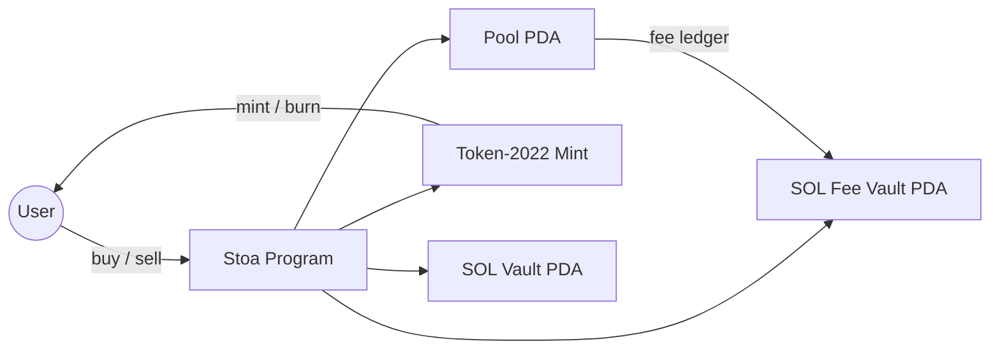

# Stoa Core

[](https://github.com/lukema95/stoa-core/actions/workflows/ci.yml)
[](LICENSE)
[](docs/09-security.md)

[English](README.md) | [简体中文](README.zh.md)

Stoa is an open-source Solana program for launching tokens on a quadratic bonding curve. It combines continuous mint/burn pricing with protocol fees, creator fees, contributor revenue sharing, and cross-pool buybacks.

> **Status: alpha, unaudited; devnet deployment pending.** The program has not been audited. Do not deploy to mainnet or use with real funds without an independent security review. See [Security](docs/09-security.md).

## Why Stoa

Launching a token usually requires a counterparty: an AMM needs two-sided liquidity, an order book needs market makers, and a fixed-price sale needs a treasury. Stoa replaces all three with a public curve:

- **Continuous pricing** — the price of the next share is determined by current supply, not by a counterparty.
- **No graduation step** — the curve is the market for the entire lifecycle of the token.
- **On-chain fee ledger** — protocol, creator, and contributor shares are accounted for on-chain.
- **Composable fee routing** — a pool can route part of its creator fee to another Stoa pool, creating a buyback between related tokens.

## Features

- **Quadratic bonding curve** — `f(x) = (x - c)²`, priced in SOL, with a creator premint floor.
- **Token-2022** — the pool owns mint authority after `create_pool`; buys mint, sells burn.
- **Program-owned vaults** — the SOL reserve and fee vault are PDAs owned by the program.
- **Two-layer fees** — `protocol_fees` and `creator_fees`, both expressed as percentages.
- **Fee sharing** — up to 10 user or pool recipients per pool.
- **Cross-pool buybacks** — a pool recipient's claim mints shares of the target pool along its own curve.

## Architecture at a glance



A pool is a set of accounts, not a single account:

- `CurveConfiguration` — global singleton: admin, protocol fee, creator premint, creator fee.
- `Pool` — per-mint economics: creator, token, supply, reserve, fee recipients.
- `pool_sol_vault` — curve reserve.
- `pool_sol_fee_vault` — unclaimed creator fee shares.
- Pool ATA — pool-owned token account, reserved for integrations.
- User ATA — buyer/seller token account.

See [Architecture](docs/01-architecture.md) and [Accounts & PDAs](docs/02-accounts-pdas.md).

## Repository layout

```text
programs/stoa/       Anchor program (Rust)
tests/               Anchor integration tests (TypeScript)
docs/                Bilingual documentation (English + 简体中文)
scripts/             Repository checks (program ID, docs parity)
.github/             CI, issue templates, contribution templates
```

## Quick start

### Prerequisites

- Rust stable (1.88+; pinned in `rust-toolchain.toml`)
- Solana CLI 2.1.x
- Anchor CLI 0.32.1
- Node.js 20+ and Yarn 1.22+

### Build and test

```bash
yarn install
anchor build
anchor test --validator legacy
```

`anchor test --validator legacy` starts a local Solana validator, deploys the program, and runs the TypeScript integration tests. Anchor 0.32 defaults to Surfpool; the `legacy` flag uses the standard `solana-test-validator`.

### Program ID

The canonical ID for this repository is:

```text
7kn2AcW5rJStbiAdKKrZ4cfZGR32eERDzPch7wJQk8xM
```

It is configured for `localnet` and `devnet` in `Anchor.toml`. The program keypair is **not** committed; create or restore it at `target/deploy/stoa-keypair.json` before deploying. See [Deployment](docs/08-deployment.md).

## Instructions

| Instruction | Who can call | Purpose |
|---|---|---|
| `initialize` | Protocol admin (first caller) | Create the global `CurveConfiguration` |
| `create_pool` | Any payer | Create a pool, take mint authority, premint creator shares |
| `buy` | Anyone | Mint shares to the buyer at the current curve price |
| `sell` | Share holder | Burn shares and pay SOL from the reserve |
| `distribute_user_fee` | Pool creator | Assign a fee share to a user address |
| `distribute_pool_fee` | Pool creator | Assign a fee share to another pool |
| `claim_user_fees` | Fee recipient | Claim accrued SOL fees |
| `claim_pool_fees` | Target pool creator | Use source-pool fees to buy target-pool shares |

## Fees

- `protocol_fees` — percent of the curve price, paid to `CurveConfiguration.admin`.
- `creator_fees` — percent of the curve price, split between the pool creator and configured recipients.
- On **buy**, fees are paid by the buyer **in addition to** the curve price.
- On **sell**, fees are deducted from the curve proceeds.
- Fee shares are capped at 100% in total.

See [Fee System](docs/05-fee-system.md) for formulas, rounding, and worked examples.

## Documentation

All documentation is maintained in English and Simplified Chinese.

| Document | English | 简体中文 |
|---|---|---|
| Documentation index | [docs/README.md](docs/README.md) | [docs/README.zh.md](docs/README.zh.md) |
| Architecture | [01-architecture.md](docs/01-architecture.md) | [01-architecture.zh.md](docs/01-architecture.zh.md) |
| Accounts & PDAs | [02-accounts-pdas.md](docs/02-accounts-pdas.md) | [02-accounts-pdas.zh.md](docs/02-accounts-pdas.zh.md) |
| Bonding curve | [03-bonding-curve.md](docs/03-bonding-curve.md) | [03-bonding-curve.zh.md](docs/03-bonding-curve.zh.md) |
| Core flows | [04-core-flows.md](docs/04-core-flows.md) | [04-core-flows.zh.md](docs/04-core-flows.zh.md) |
| Fee system | [05-fee-system.md](docs/05-fee-system.md) | [05-fee-system.zh.md](docs/05-fee-system.zh.md) |
| Integrator guide | [06-integrators.md](docs/06-integrators.md) | [06-integrators.zh.md](docs/06-integrators.zh.md) |
| Testing | [07-testing.md](docs/07-testing.md) | [07-testing.zh.md](docs/07-testing.zh.md) |
| Deployment | [08-deployment.md](docs/08-deployment.md) | [08-deployment.zh.md](docs/08-deployment.zh.md) |
| Security model | [09-security.md](docs/09-security.md) | [09-security.zh.md](docs/09-security.zh.md) |
| Release process | [10-release.md](docs/10-release.md) | [10-release.zh.md](docs/10-release.zh.md) |
| FAQ | [11-faq.md](docs/11-faq.md) | [11-faq.zh.md](docs/11-faq.zh.md) |

## Integrators

`anchor build` produces:

- `target/idl/stoa.json` — Anchor IDL
- `target/types/stoa.ts` — TypeScript types
- `target/deploy/stoa.so` — SBF program

The IDL package is not published yet. Until then, consume the generated artifacts and keep the program ID in sync. The [Integrator Guide](docs/06-integrators.md) documents PDA derivation, instruction accounts, events, and error codes. A versioned `@stoa/idl` package is planned in the [release process](docs/10-release.md).

## Security

Stoa is **alpha software and has not been audited**. See [SECURITY.md](SECURITY.md) for the disclosure policy and [docs/09-security.md](docs/09-security.md) for the threat model, invariants, and known limitations.

## Contributing, support, and governance

- [CONTRIBUTING.md](CONTRIBUTING.md) — development setup, tests, and pull request process.
- [CODE_OF_CONDUCT.md](CODE_OF_CONDUCT.md) — community standards.
- [SUPPORT.md](SUPPORT.md) — where to ask questions and report bugs.
- [GOVERNANCE.md](GOVERNANCE.md) — maintainer roles and decision process.
- [MAINTAINERS.md](MAINTAINERS.md) — current maintainers.
- [CHANGELOG.md](CHANGELOG.md) — release history.

## License

MIT. See [LICENSE](LICENSE). A non-binding Chinese reference translation is available at [LICENSE.zh.md](LICENSE.zh.md).
