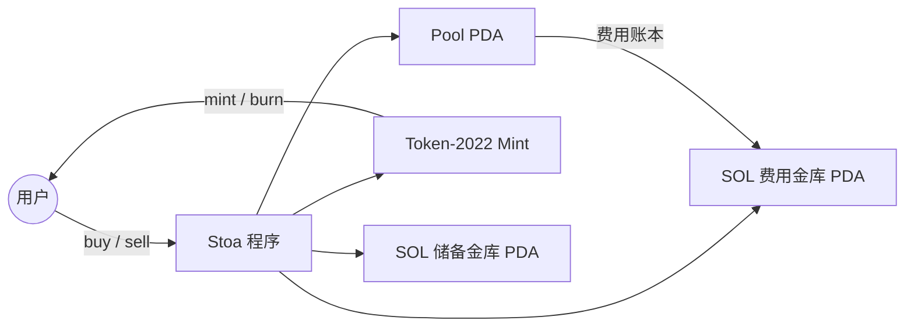

# Stoa Core

[](https://github.com/lukema95/stoa-core/actions/workflows/ci.yml)
[](LICENSE)
[](docs/09-security.zh.md)

[English](README.md) | [简体中文](README.zh.md)

Stoa 是一个开源 Solana 程序，用二次联合曲线发行代币。它把连续铸销定价、协议费、创建者费、贡献者分润和跨池回购组合在一起。

> **状态：alpha、未审计；devnet 部署待完成。** 程序尚未经过审计。在没有独立安全审查的情况下，不要部署到主网，也不要用真实资金。参见[安全模型](docs/09-security.zh.md)。

## 为什么需要 Stoa

发行代币通常需要对手方：AMM 需要双边流动性，订单簿需要做市商，固定价格销售需要金库。Stoa 用一条公开曲线替代这三者：

- **连续定价** —— 下一枚 Share 的价格由当前供给决定，而不是由对手方决定。
- **不毕业** —— 曲线就是代币全生命周期的市场。
- **链上费用账本** —— 协议、创建者、贡献者的份额都在链上记账。
- **可组合的费用路由** —— 一个池可以把部分创建者费路由到另一个 Stoa 池，形成关联代币之间的回购。

## 特性

- **二次联合曲线** —— `f(x) = (x - c)²`，以 SOL 计价，带有创建者预铸地板。
- **Token-2022** —— `create_pool` 之后由池子持有 mint authority；买入铸币，卖出销毁。
- **程序拥有的金库** —— SOL 储备和费用金库都是程序拥有的 PDA。
- **两层费用** —— `protocol_fees` 和 `creator_fees`，都以百分比表示。
- **费用分润** —— 每个池最多 10 个用户或池子接收者。
- **跨池回购** —— 池子接收者领取时，沿目标池自己的曲线买入目标池 Share。

## 架构总览



一个池子是一组账户，而不是单个账户：

- `CurveConfiguration` —— 全局单例：admin、协议费、创建者预铸量、创建者费。
- `Pool` —— 每个 mint 一份：创建者、代币、供给、储备、费用接收者。
- `pool_sol_vault` —— 曲线储备。
- `pool_sol_fee_vault` —— 未领取的创建者费份额。
- Pool ATA —— 池子拥有的代币账户，预留给集成方。
- User ATA —— 买方/卖方的代币账户。

参见[架构](docs/01-architecture.zh.md)和[账户与 PDA](docs/02-accounts-pdas.zh.md)。

## 仓库结构

```text
programs/stoa/       Anchor 程序（Rust）
tests/               Anchor 集成测试（TypeScript）
docs/                双语文档（English + 简体中文）
scripts/             仓库检查脚本（program ID、文档配对）
.github/             CI、issue 模板、贡献模板
```

## 快速开始

### 环境要求

- Rust stable（1.88+；由 `rust-toolchain.toml` 固定）
- Solana CLI 2.1.x
- Anchor CLI 0.32.1
- Node.js 20+ 和 Yarn 1.22+

### 构建与测试

```bash
yarn install
anchor build
anchor test --validator legacy
```

`anchor test --validator legacy` 会启动本地 Solana 验证器、部署程序并运行 TypeScript 集成测试。Anchor 0.32 默认使用 Surfpool；`legacy` 参数会使用标准的 `solana-test-validator`。

### Program ID

本仓库的 canonical ID：

```text
7kn2AcW5rJStbiAdKKrZ4cfZGR32eERDzPch7wJQk8xM
```

它已在 `Anchor.toml` 中配置到 `localnet` 和 `devnet`。程序 keypair **不会**提交；部署前请在 `target/deploy/stoa-keypair.json` 创建或恢复。参见[部署](docs/08-deployment.zh.md)。

## 指令

| 指令 | 调用者 | 作用 |
|---|---|---|
| `initialize` | 协议管理员（首个调用者） | 创建全局 `CurveConfiguration` |
| `create_pool` | 任意 payer | 创建池子、接管 mint authority、预铸创建者份额 |
| `buy` | 任何人 | 按当前曲线价格向买方铸币 |
| `sell` | Share 持有者 | 销毁 Share，从储备中支付 SOL |
| `distribute_user_fee` | 池创建者 | 给用户地址分配费用份额 |
| `distribute_pool_fee` | 池创建者 | 给另一个池分配费用份额 |
| `claim_user_fees` | 费用接收者 | 领取已累积的 SOL 费用 |
| `claim_pool_fees` | 目标池创建者 | 用源池费用买入目标池 Share |

## 费用

- `protocol_fees` —— 曲线价格的百分比，支付给 `CurveConfiguration.admin`。
- `creator_fees` —— 曲线价格的百分比，在池创建者和配置的接收者之间分配。
- **买入**时，费用由买方在曲线价格**之外**支付。
- **卖出**时，费用从曲线收入中扣除。
- 费用份额总和上限为 100%。

公式、取整和示例见[费用系统](docs/05-fee-system.zh.md)。

## 文档

所有文档都维护英文和简体中文两个版本。

| 文档 | English | 简体中文 |
|---|---|---|
| 文档索引 | [docs/README.md](docs/README.md) | [docs/README.zh.md](docs/README.zh.md) |
| 架构 | [01-architecture.md](docs/01-architecture.md) | [01-architecture.zh.md](docs/01-architecture.zh.md) |
| 账户与 PDA | [02-accounts-pdas.md](docs/02-accounts-pdas.md) | [02-accounts-pdas.zh.md](docs/02-accounts-pdas.zh.md) |
| 联合曲线 | [03-bonding-curve.md](docs/03-bonding-curve.md) | [03-bonding-curve.zh.md](docs/03-bonding-curve.zh.md) |
| 核心流程 | [04-core-flows.md](docs/04-core-flows.md) | [04-core-flows.zh.md](docs/04-core-flows.zh.md) |
| 费用系统 | [05-fee-system.md](docs/05-fee-system.md) | [05-fee-system.zh.md](docs/05-fee-system.zh.md) |
| 集成指南 | [06-integrators.md](docs/06-integrators.md) | [06-integrators.zh.md](docs/06-integrators.zh.md) |
| 测试 | [07-testing.md](docs/07-testing.md) | [07-testing.zh.md](docs/07-testing.zh.md) |
| 部署 | [08-deployment.md](docs/08-deployment.md) | [08-deployment.zh.md](docs/08-deployment.zh.md) |
| 安全模型 | [09-security.md](docs/09-security.md) | [09-security.zh.md](docs/09-security.zh.md) |
| 发布流程 | [10-release.md](docs/10-release.md) | [10-release.zh.md](docs/10-release.zh.md) |
| FAQ | [11-faq.md](docs/11-faq.md) | [11-faq.zh.md](docs/11-faq.zh.md) |

## 集成方

`anchor build` 会生成：

- `target/idl/stoa.json` —— Anchor IDL
- `target/types/stoa.ts` —— TypeScript 类型
- `target/deploy/stoa.so` —— SBF 程序

IDL 包尚未发布。在此之前，请直接使用生成产物，并保持 program ID 同步。[集成指南](docs/06-integrators.zh.md)记录了 PDA 推导、指令账户、事件和错误码。带版本的 `@stoa/idl` 包已列入[发布流程](docs/10-release.zh.md)。

## 安全

Stoa 是 **alpha 软件且未审计**。披露政策见 [SECURITY.zh.md](SECURITY.zh.md)，威胁模型、不变量和已知限制见 [docs/09-security.zh.md](docs/09-security.zh.md)。

## 贡献、支持与治理

- [CONTRIBUTING.zh.md](CONTRIBUTING.zh.md) —— 开发环境、测试和 PR 流程。
- [CODE_OF_CONDUCT.zh.md](CODE_OF_CONDUCT.zh.md) —— 社区标准。
- [SUPPORT.zh.md](SUPPORT.zh.md) —— 提问和报告 bug 的渠道。
- [GOVERNANCE.zh.md](GOVERNANCE.zh.md) —— 维护者角色和决策流程。
- [MAINTAINERS.zh.md](MAINTAINERS.zh.md) —— 当前维护者。
- [CHANGELOG.zh.md](CHANGELOG.zh.md) —— 发布历史。

## 许可证

MIT。参见 [LICENSE](LICENSE)。非约束性中文参考翻译见 [LICENSE.zh.md](LICENSE.zh.md)。
