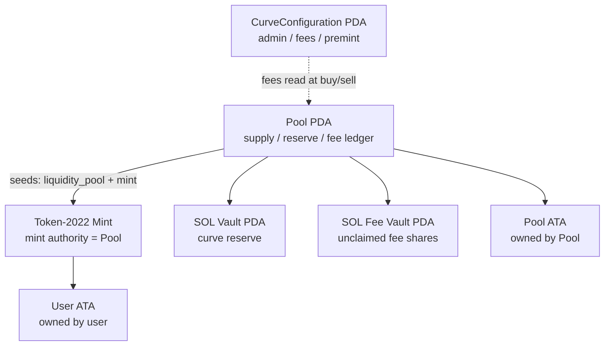
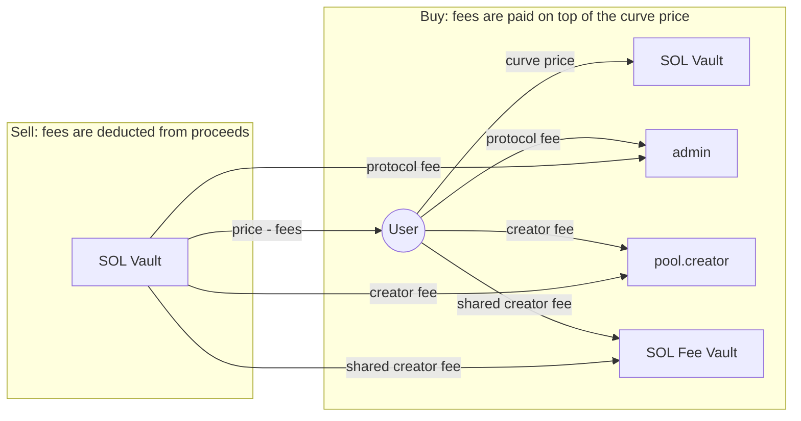

# 01 Architecture

[English](01-architecture.md) | [简体中文](01-architecture.zh.md)

## 1. What Stoa is

Stoa is a Solana program that gives a Token-2022 mint a continuous, on-chain
market:

1. A creator brings a Token-2022 mint and calls `create_pool`.
2. The pool takes mint authority, premints a configured amount to the creator,
   and records the curve origin.
3. Anyone can `buy` shares along the curve, paying SOL into the pool reserve.
4. Holders can `sell` shares back into the reserve; the shares are burned.
5. Trading fees flow to the protocol, the pool creator, and configured
   recipients. Pool recipients can use their fees to buy shares of another pool.

There is no AMM and no graduation step. The curve itself is the market.

## 2. Design principles

- **One pool per mint.** The pool PDA is derived from the mint, so a mint cannot
  have two pools.
- **Program-owned SOL.** The reserve and fee vaults are PDAs owned by the
  program. This lets the program debit them without a System Program CPI.
- **Mint/burn liquidity.** Shares are minted on buy and burned on sell; there is
  no pre-funded token side of the pool.
- **Explicit fee ledger.** Each fee recipient's accrued and unclaimed fees are
  stored on-chain.
- **Thin instruction handlers.** Account constraints live in
  `#[derive(Accounts)]`; pricing and accounting live in `state.rs`.

## 3. On-chain vs off-chain

On-chain:

- Curve pricing and supply accounting.
- Mint/burn authority.
- SOL vault custody.
- Fee calculation, allocation, and claims.
- Authorization: who may distribute fees, who may claim.

Off-chain:

- Discovering mints and creating metadata.
- Building transactions and computing slippage limits.
- Indexing events into a database.
- Any application-level identity or ownership checks (for example, proving
  that a creator controls a repository).

The program itself does not know about GitHub, web accounts, or off-chain
metadata. Those are integrator concerns.

## 4. Program modules

```text
programs/stoa/src/
├── lib.rs          #[program] instruction dispatch
├── state.rs        Account structs, curve math, fee accounting, events
├── errors.rs       CustomError
└── instructions/
    ├── initialize.rs
    ├── create_pool.rs
    ├── buy.rs
    ├── sell.rs
    ├── claim.rs
    └── distribute_fee.rs
```

`#[derive(Accounts)]` answers **who may pass which accounts**; the methods on
`Account<Pool>` answer **what happens after validation**.

## 5. Instructions

| Instruction | Caller | Purpose |
|---|---|---|
| `initialize` | First caller / protocol admin | Create the global `CurveConfiguration` |
| `create_pool` | Any payer | Create a pool, take mint authority, premint creator shares |
| `buy` | Anyone | Mint shares to the buyer at the current curve price |
| `sell` | Share holder | Burn shares and pay SOL from the reserve |
| `distribute_user_fee` | Pool creator | Assign a fee share to a user address |
| `distribute_pool_fee` | Pool creator | Assign a fee share to another pool |
| `claim_user_fees` | Fee recipient | Claim accrued SOL fees |
| `claim_pool_fees` | Target pool creator | Use source-pool fees to buy target-pool shares |

## 6. Runtime accounts



A pool is a set of accounts, not a single account. `Pool` stores the economics;
the vaults hold the SOL; the mint holds the token supply.

## 7. Fund flows



The asymmetry is intentional:

- On buy, the buyer pays `curve price + protocol fee + creator fee`; the reserve
  increases by the full curve price.
- On sell, the seller receives `curve price - protocol fee - creator fee`; the
  reserve decreases by the full curve price.

`pool.reserve_sol` therefore tracks the sum of curve prices, not the sum of SOL
that users actually paid.

## 8. Security boundaries

Guaranteed by the program:

- One pool per mint.
- Mint authority moves to the pool; only the program can mint afterwards.
- Supply cannot be sold below the creator premint floor.
- Fee shares are capped at 100% in total.
- A pool cannot allocate fees to itself.
- Pool vaults are PDAs owned by the program.

Left to integrators or deployment procedure:

- Proving that a pool creator is entitled to tokenize a particular asset.
- Choosing fee parameters and the protocol admin.
- Enforcing slippage limits (`max_sol_in` / `min_sol_out`) — not yet part of the
  on-chain interface.
- Protecting the upgrade authority.

See [09-security.md](./09-security.md) for known limitations.

## 9. Upgrade and deployment

- `declare_id!` in `lib.rs` is the canonical program ID.
- `Anchor.toml` must use the same ID for each cluster.
- The program keypair is not committed. Generate it under
  `target/deploy/stoa-keypair.json` and back it up before deploying.
- For production, put the upgrade authority behind a multisig and document the
  upgrade policy.

See [08-deployment.md](./08-deployment.md) for commands.
