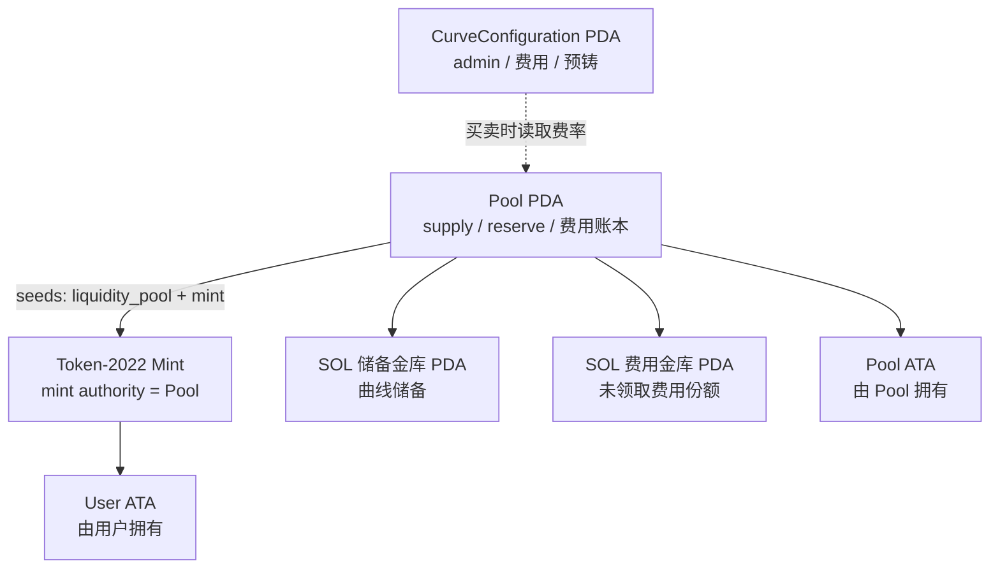
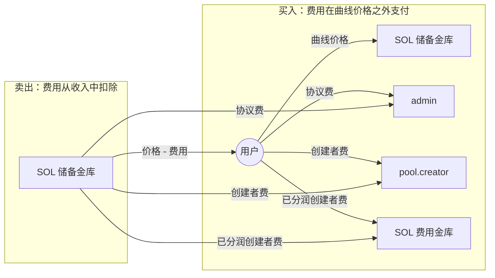

# 01 架构

[English](01-architecture.md) | [简体中文](01-architecture.zh.md)

## 1. Stoa 是什么

Stoa 是一个 Solana 程序，为 Token-2022 mint 提供一个持续的链上市场：

1. 创建者准备一个 Token-2022 mint，并调用 `create_pool`。
2. 池子接管 mint authority，向创建者预铸配置的数量，并记录曲线原点。
3. 任何人都可以沿曲线 `buy` Share，把 SOL 支付到池子储备。
4. 持有者可以把 Share `sell` 回储备；Share 会被销毁。
5. 交易费用流向协议、池创建者和配置的接收者。池子接收者可以用自己的费用
   买入另一个池子的 Share。

没有 AMM，也没有毕业机制。曲线本身就是市场。

## 2. 设计原则

- **每个 mint 一个池子。** Pool PDA 由 mint 推导，所以一个 mint 不可能有两个池子。
- **程序拥有的 SOL。** 储备金库和费用金库都是程序拥有的 PDA，程序可以直接扣款，
  不需要 System Program CPI。
- **Mint/burn 流动性。** 买入时铸币，卖出时销毁；池子没有预注入的代币一侧。
- **显式费用账本。** 每个费用接收者的累计费用和未领取费用都存储在链上。
- **薄指令处理函数。** 账户约束放在 `#[derive(Accounts)]`；定价和记账放在
  `state.rs`。

## 3. 链上与链下

链上：

- 曲线定价和供给记账。
- Mint/burn 权限。
- SOL 金库托管。
- 费用计算、分配和领取。
- 授权：谁可以分发费用，谁可以领取。

链下：

- 发现 mint 和创建 metadata。
- 构造交易和计算滑点限制。
- 把事件索引到数据库。
- 应用层的身份或所有权校验（例如证明创建者控制某个仓库）。

程序本身不认识 GitHub、Web 账户或链下 metadata；这些是集成方的事情。

## 4. 程序模块

```text
programs/stoa/src/
├── lib.rs          #[program] 指令分发
├── state.rs        账户结构、曲线数学、费用记账、事件
├── errors.rs       CustomError
└── instructions/
    ├── initialize.rs
    ├── create_pool.rs
    ├── buy.rs
    ├── sell.rs
    ├── claim.rs
    └── distribute_fee.rs
```

`#[derive(Accounts)]` 回答**谁可以传哪些账户**；`Account<Pool>` 上的方法回答
**校验之后发生什么**。

## 5. 指令

| 指令 | 调用者 | 作用 |
|---|---|---|
| `initialize` | 首个调用者 / 协议管理员 | 创建全局 `CurveConfiguration` |
| `create_pool` | 任意 payer | 创建池子、接管 mint authority、预铸创建者份额 |
| `buy` | 任何人 | 按当前曲线价格向买方铸币 |
| `sell` | Share 持有者 | 销毁 Share，从储备中支付 SOL |
| `distribute_user_fee` | 池创建者 | 给用户地址分配费用份额 |
| `distribute_pool_fee` | 池创建者 | 给另一个池分配费用份额 |
| `claim_user_fees` | 费用接收者 | 领取已累积的 SOL 费用 |
| `claim_pool_fees` | 目标池创建者 | 用源池费用买入目标池 Share |

## 6. 运行时账户



一个池子是一组账户，不是单个账户。`Pool` 存储经济参数；金库持有 SOL；mint
持有代币供给。

## 7. 资金流



这种不对称是刻意的：

- 买入时，买方支付 `曲线价格 + 协议费 + 创建者费`；储备增加完整的曲线价格。
- 卖出时，卖方收到 `曲线价格 - 协议费 - 创建者费`；储备减少完整的曲线价格。

因此 `pool.reserve_sol` 跟踪的是曲线价格之和，而不是用户实际支付的 SOL 之和。

## 8. 安全边界

程序保证：

- 每个 mint 一个池子。
- Mint authority 转移给池子；之后只有程序可以 mint。
- 供给不能卖到创建者预铸地板以下。
- 费用份额总和上限为 100%。
- 池子不能把费用分配给自己。
- 池子金库是程序拥有的 PDA。

留给集成方或部署流程：

- 证明池创建者有权代币化某个资产。
- 选择费用参数和协议管理员。
- 执行滑点限制（`max_sol_in` / `min_sol_out`）——目前还不是链上接口的一部分。
- 保护 upgrade authority。

已知限制见 [09-security.zh.md](./09-security.zh.md)。

## 9. 升级与部署

- `lib.rs` 中的 `declare_id!` 是 canonical program ID。
- `Anchor.toml` 在各个 cluster 上必须使用同一个 ID。
- 程序 keypair 不会提交。在 `target/deploy/stoa-keypair.json` 生成，并在部署前备份。
- 生产环境应把 upgrade authority 放在多签后面，并记录升级策略。

命令见 [08-deployment.zh.md](./08-deployment.zh.md)。
