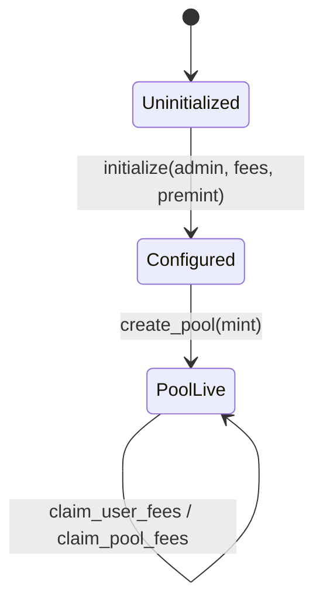
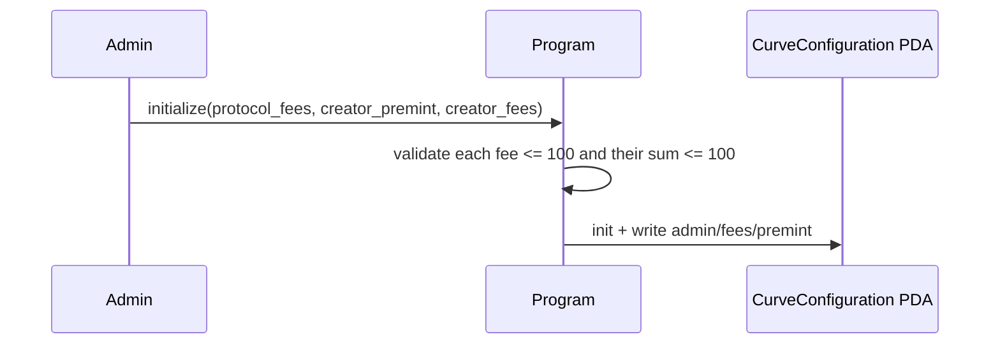
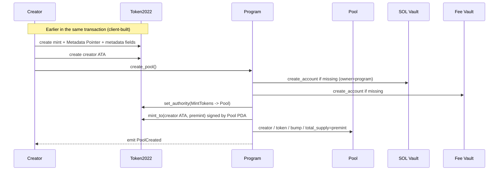
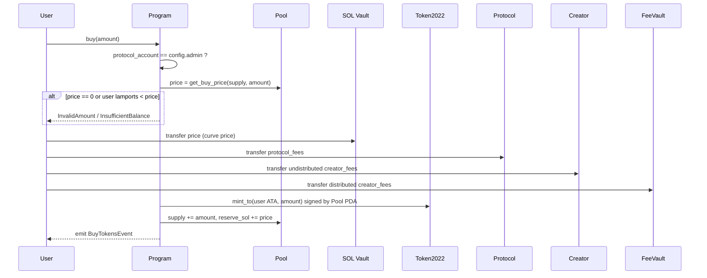
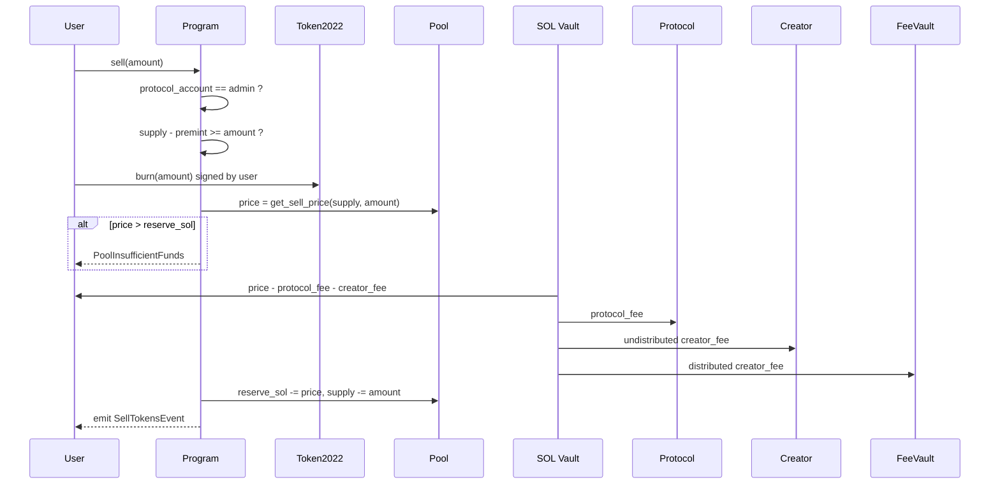
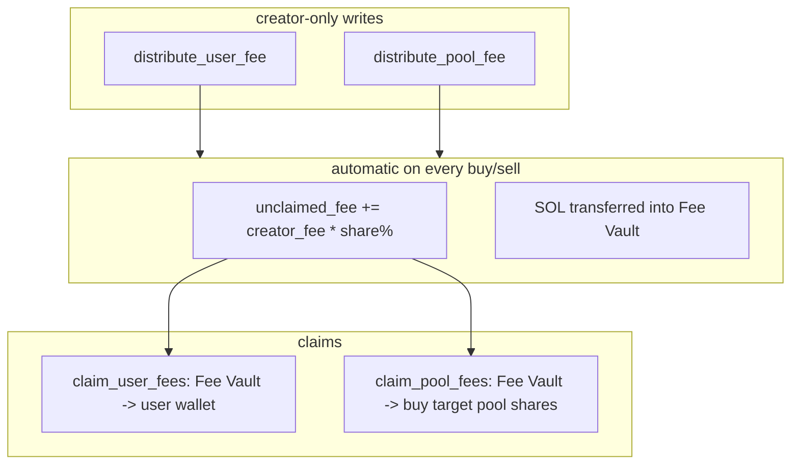

# 04 Core Flows

[English](04-core-flows.md) | [简体中文](04-core-flows.zh.md)

This chapter follows the actual call order. The "client" in the sequence diagrams includes the Token-2022 instructions that an integrator builds.

## 0. Lifecycle



A cluster needs `initialize` once. After that, each mint gets one `create_pool`.

---

## 1. `initialize`

**Caller:** the protocol admin (the payer becomes the future `admin` and protocol fee recipient).



Test defaults: `protocol_fees=2`, `creator_fees=5`, `creator_premint=1e9`.

There is no update instruction. Fees are protocol-level constants.

Because the first caller becomes the admin, deploy and initialize as part of one controlled deployment job. See [08-deployment.md](./08-deployment.md).

---

## 2. `create_pool`

This is the on-chain step that turns a Token-2022 mint into a Stoa pool. The program does not inspect off-chain identity; it only checks that the mint exists and that the payer currently controls mint authority.



Details:

- The SOL vault and fee vault are created with `system_program::create_account` and signed with their own seeds. They have zero data and are funded rent-exempt. Their owner is the **Stoa program**, which is what allows the program to debit them directly on sell.
- Mint authority is transferred after the Pool PDA is initialized, because the new authority is the Pool address.
- `pool_token_account` is the Pool's ATA. The current buy/sell paths do not move tokens into it (buys mint directly to the user), but it is created for future integrations.

Integrators usually build "create mint + write metadata + create ATA + create_pool" into **one transaction**, so a failure cannot leave a mint without a pool.

---

## 3. `buy(amount_tokens)`

The user specifies **how many shares to buy**, not how much SOL to spend. The program integrates the curve at the current `total_supply`.



Funding order: the full curve price enters the reserve first; fees are charged **on top** from the buyer's wallet. `reserve_sol += price` includes neither fee.

The event `price` is `get_buy_price_after_fees` computed **before** `total_supply += amount`, so it represents the fee-inclusive price of this trade. Indexers can use it directly; for exact lamports, cross-check the transfer instructions.

**There is no on-chain slippage limit.** The user signs only `amount_tokens`. If a searcher buys first, supply moves up and the user pays more SOL for the same number of shares. Production integrations should enforce a client-side `max_sol_in` check or wait for a future on-chain parameter.

---

## 4. `sell(amount_tokens)`



Three asymmetries compared with buy:

1. **Burn happens before pricing.** If a later step fails, the whole transaction reverts, including the burn.
2. Fees come **out of the reserve**; the user receives the net amount.
3. Floor: `total_supply` cannot be sold below `premint`.

There is no `min_sol_out`.

---

## 5. Invariants after trades

Ignoring the fee vault (fees are not part of the curve):

```text
pool.reserve_sol  ==  sum(buy curve prices) - sum(sell curve prices)
pool.total_supply ==  premint + net shares bought
SOL Vault lamports ~= rent-exempt + reserve_sol
```

On buy, fees do **not** enter the vault:

```text
vault increase = price
user decrease  = price + all fees
```

On sell:

```text
vault decrease = price
user increase  = price - all fees
fee recipients increase = all fees
```

The vault decreases by the full pre-fee `price`, and the fee portion leaves the vault to the recipients, so the accounting remains consistent.

---

## 6. Fee configuration and claims

Fee sharing does not change the curve; it only determines how the **creator fee** is split. The protocol fee always goes 100% to `admin`.



Full rules are in [05-fee-system.md](./05-fee-system.md).

---

## 7. Instruction and account summary

| Instruction | Required signer | Key PDAs | External programs |
|---|---|---|---|
| `initialize` | admin | `CurveConfiguration` | System |
| `create_pool` | payer | `Pool`, both vaults | System, Token-2022, ATA |
| `buy` | user | pool, vaults, config | System, Token-2022, ATA |
| `sell` | user | pool, vaults | System, Token-2022, ATA |
| `distribute_user_fee` | `pool.creator` | `Pool` | System |
| `distribute_pool_fee` | `pool.creator` | source pool + target pool | System |
| `claim_user_fees` | fee recipient | `Pool` + fee vault | System |
| `claim_pool_fees` | target pool creator | both pools and vaults | System, Token-2022 |

Compute budget: when `create_pool` shares a transaction with Token-2022 metadata initialization, clients usually add a `ComputeBudgetProgram` instruction. Token-2022 plus metadata initialization is relatively expensive.
