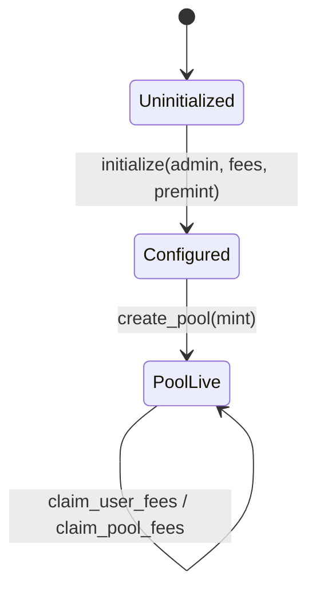
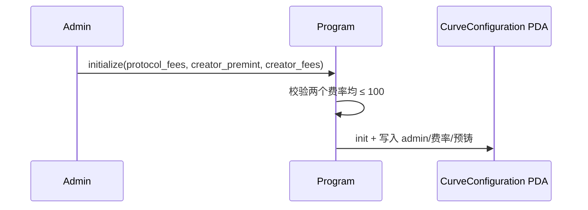
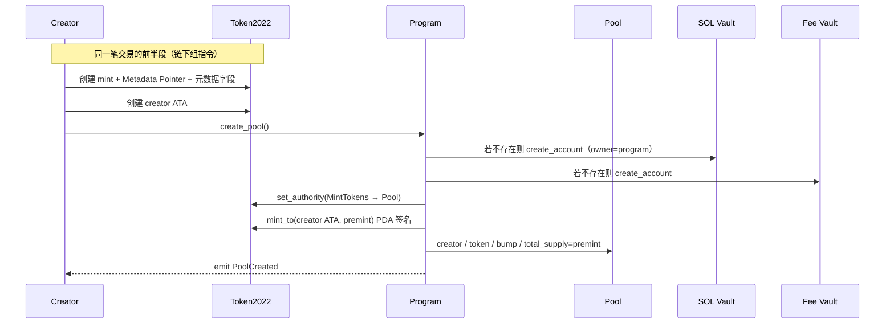
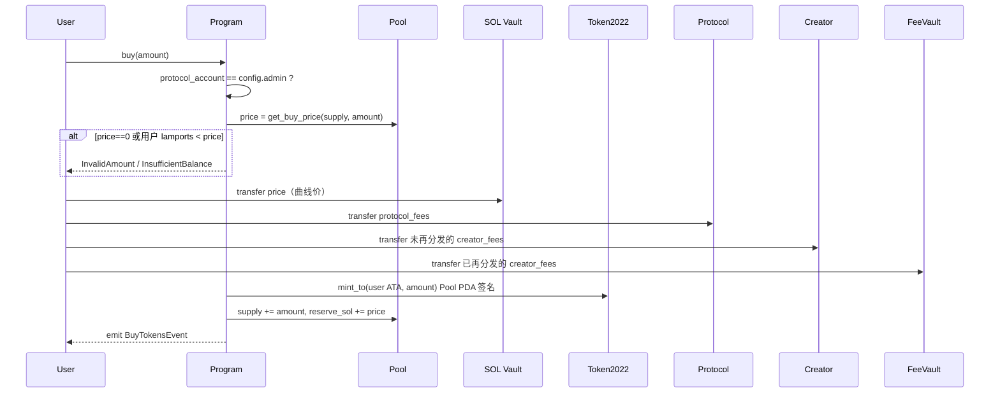
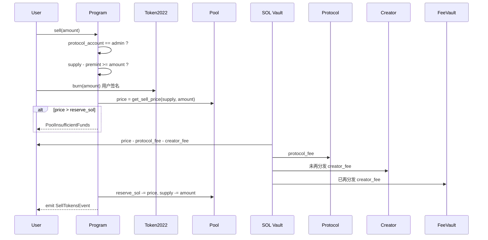
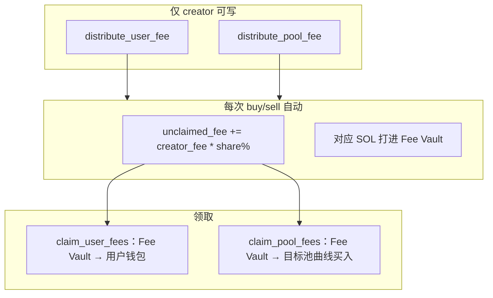

# 04 核心流程

[English](04-core-flows.md) | [简体中文](04-core-flows.zh.md)

本章按真实调用顺序写。时序图里的「客户端」包含 website 组出来的 Token-2022 指令。

## 0. 生命周期总图



一个集群只需 `initialize` 一次；之后每个 mint 对应一次 `create_pool`。

---

## 1. `initialize`

**调用者**：协议管理员（payer = 未来的 `admin` / 协议费收款地址）。



测试默认：`protocol_fees=2`，`creator_fees=5`，`creator_premint=1e9`。

没有更新指令。费率是协议级常量。

---

## 2. `create_pool`

这是把 Token-2022 mint 变成 Stoa 池子的链上步骤。程序不检查链下身份，只检查：mint 已存在，且 payer 当前控制 mint authority。



关键细节：

- SOL vault / fee vault 用 `system_program::create_account` + vault 自己的 seeds 签名，空间 0、lamports = rent exempt。owner 设为 **stoa program**，这才能在卖出时直接改 lamports。
- mint authority 转移发生在 Pool `init` 之后，因为 authority 目标是 Pool 地址。
- `pool_token_account` 是 Pool 的 ATA，当前买卖路径并不把代币放进这个账户（买直接 mint 给用户），但建池时仍然创建，给后续扩展留位。

Frontend 把「建 mint + 写 metadata + 建 ATA + create_pool」打进**同一笔交易**，失败则全部回滚，避免出现「有币无池」。

---

## 3. `buy(amount_tokens)`

用户指定 **要买多少枚**，不是指定花多少 SOL。链上按当前 `total_supply` 积分出价。



资金顺序：**先把完整曲线价打进储备，再额外收税**。`reserve_sol += price` 不加也不减手续费。

事件里的 `price` 是 `get_buy_price_after_fees` 在 `total_supply += amount` **之前**算出的值，对应本笔成交的含费价格。索引器可以直接使用；如果需要精确到 lamports，仍建议结合转账指令核对。

**目前没有链上滑点上限。** 用户签名时只锁死 `amount_tokens`。若打包前被夹子先买，供给上移，用户仍买到这么多枚，但付出的 SOL 更高。生产集成应在客户端设置 `max_sol_in` 检查，或等待后续版本加入链上参数。

---

## 4. `sell(amount_tokens)`



和买的三点不对称：

1. **先烧币再出价**。若后面失败整笔回滚，burn 也会回滚，安全。
2. 税从**储备**出，用户收到净额。
3. 地板：不能把 `total_supply` 卖到 `premint` 以下。

同样没有 `min_sol_out`。

---

## 5. 买卖之后的不变量

忽略手续费金库（那是税，不属于曲线）：

```
pool.reserve_sol  ==  所有 buy 的曲线价之和  -  所有 sell 的曲线价之和
pool.total_supply ==  premint + 净买入枚数
SOL Vault lamports ≈ rent-exempt + reserve_sol
                   （卖出抽税时税从 vault 转走，但 reserve_sol 仍减的是含税前的 price，
                    税对应的 lamports 已经离开 vault，会计上仍自洽：
                    vault 减少 price，其中一部分去用户、一部分去税）
```

买入时税**不进** vault，所以买完：

```
vault 增加 = price
用户减少 = price + 全部税
```

卖出时：

```
vault 减少 = price
用户增加 = price - 全部税
税接收方增加 = 全部税
```

---

## 6. 分润配置与领取

分润不改变曲线，只改变 **creator_fees 这一刀怎么切**。协议费永远 100% 给 `admin`。



完整规则见 [05-fee-system.zh.md](./05-fee-system.zh.md)。

---

## 7. 指令与账户对照表

| 指令 | 必签 | 关键 PDA | 外部程序 |
|------|------|----------|----------|
| initialize | admin | CurveConfiguration | System |
| create_pool | payer | Pool, 两 vault | System, Token-2022, ATA |
| buy | user | 同上 + config | System, Token-2022, ATA |
| sell | user | 同上 | System, Token-2022, ATA |
| distribute_user_fee | pool.creator | Pool | System |
| distribute_pool_fee | pool.creator | 本池 + 目标池 | System |
| claim_user_fees | 分润用户 | Pool + fee vault | System |
| claim_pool_fees | 目标池 creator | 两套 Pool/vault | System, Token-2022 |

计算预算：`create_pool` 与 Token-2022 metadata 同一笔交易时，前端通常需要加 `ComputeBudgetProgram`；Token-2022 + metadata 初始化消耗较高。
