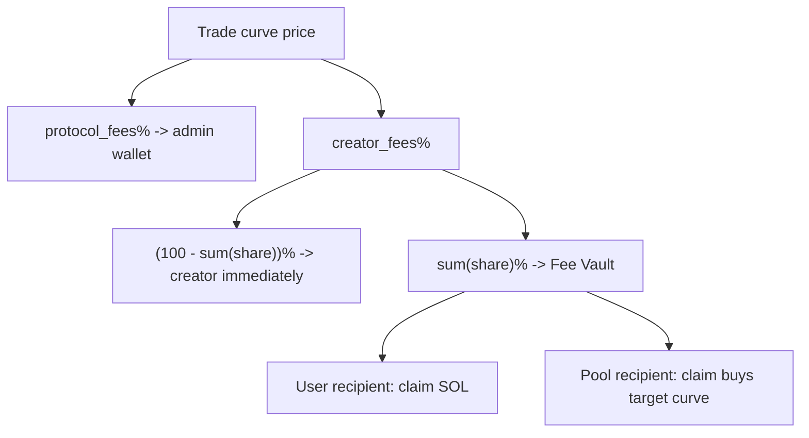
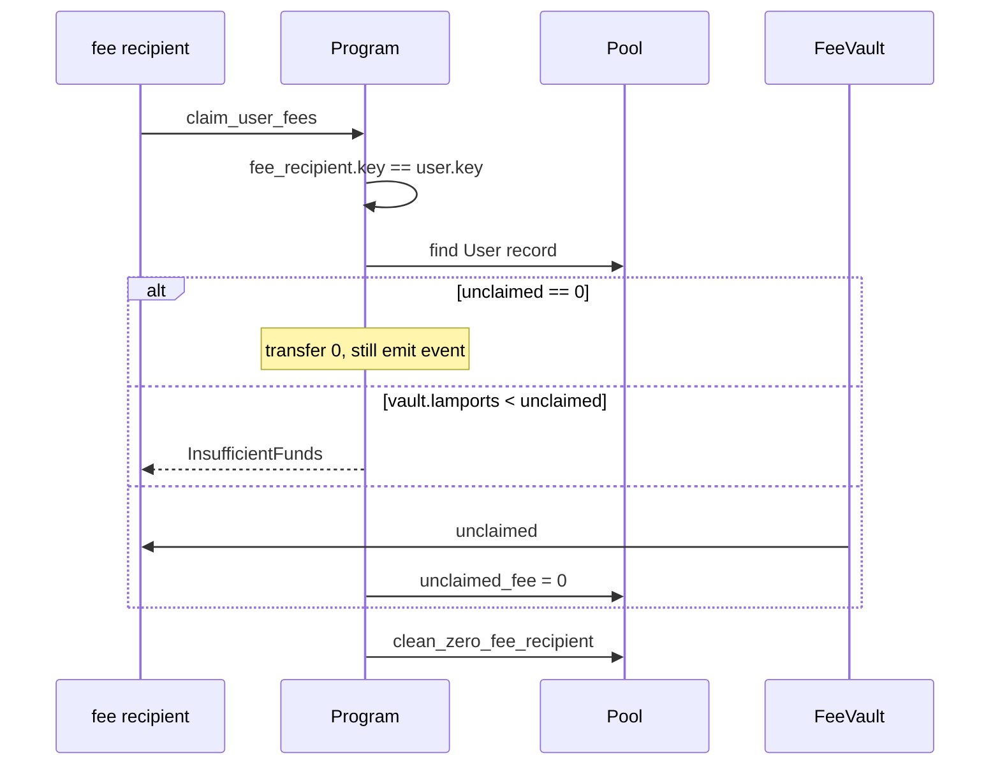
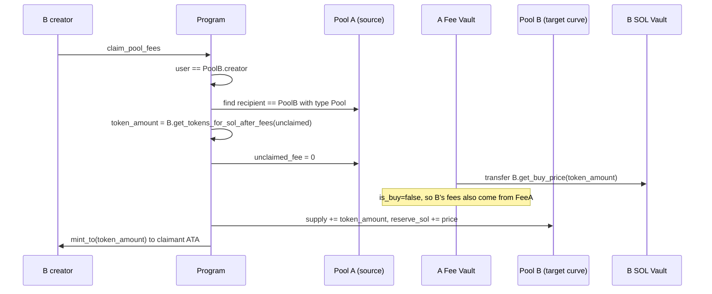

# 05 Fees and Cross-Pool Distribution

[English](05-fee-system.md) | [简体中文](05-fee-system.zh.md)

Fee routing is Stoa's main differentiator. A pool creator can share the creator fee with contributors or with **another Stoa pool**, so trading fees can buy back a related token. On-chain, this is `claim_pool_fees`.

## 1. Two fee layers

Global `CurveConfiguration`:

| Field | Default | Meaning |
|---|---|---|
| `protocol_fees` | 2 | Protocol fee, always paid to `admin` |
| `creator_fees` | 5 | Creator fee, optionally split further |

Per-pool `Pool`:

| Field | Meaning |
|---|---|
| `fee_recipients[]` | Up to 10 recipients, each `User` or `Pool` |
| `total_fee_share_percentage` | Sum of shares, at most 100 |

Creator fee on every trade:

```text
total_creator_fee = price * creator_fees / 100

pool_creator_immediate = total_creator_fee * (100 - total_fee_share_percentage) / 100
shared                 = total_creator_fee - pool_creator_immediate
```

- `pool_creator_immediate` is transferred **immediately** to `pool_creator`.
- `shared` is transferred **immediately** into the pool's `pool_sol_fee_vault` and credited to each recipient's `unclaimed_fee`.

The protocol fee is not part of this table; it is paid to `protocol_account` at trade time.



## 2. Buy vs sell: where the fee comes from

`distribute_fees(is_buy, price, ...)`:

```rust
if is_buy {
    // Three extra transfers from the user's wallet: protocol / creator / fee vault
    transfer_sol_to_user(authority, protocol, protocol_fees);
    transfer_sol_to_user(authority, pool_creator, pool_creator_fees);
    transfer_sol_to_pool(authority, fee_vault, shared);
} else {
    // Debit the supplied vault: the reserve on sell, the source fee vault on cross-pool claims
    transfer_sol_from_pool(vault, protocol, protocol_fees);
    transfer_sol_from_pool(vault, pool_creator, pool_creator_fees);
    transfer_sol_from_pool(vault, fee_vault, shared);
}
```

Accounting (both directions):

```rust
for recipient in fee_recipients.iter_mut() {
    let fee_share = total_creator_fee * share_percentage / 100;
    recipient.total_fee += fee_share;
    recipient.unclaimed_fee += fee_share;
}
```

Integer division truncates. `pool_creator_fees + sum(fee_share)` can be slightly less than `total_creator_fee`; the dust remains in the payer account. A future version may use basis points (`u16`, `/10_000`) and sum before transferring to reduce per-recipient truncation.

## 3. Configuring shares

### `distribute_user_fee(share_percentage)`

- Only `user == pool.creator`.
- `share_percentage <= 100`.
- If the address is already in the table, update its `share_percentage` instead of inserting a duplicate.
- Otherwise `push` a new `FeeRecipient { User, address, share, 0, 0 }`.
- Recompute `total_fee_share_percentage`; if it exceeds 100, the whole instruction fails.
- If the table already has 10 entries and the address is new, return `MaxFeeRecipientReached`.

### `distribute_pool_fee(share_percentage)`

Same rules, plus:

```rust
if pool.key() == distribute_fee_pool.key() {
    return Err(InvalidRecipient); // no self-distribution
}
```

The target must be a valid Pool PDA (seed-checked). A random wallet cannot impersonate a pool.

Setting a share back to 0 does not delete the row immediately because it may still have `unclaimed_fee`. Deletion happens after a claim via `clean_zero_fee_recipient`:

```rust
retain(share_percentage > 0 || unclaimed_fee > 0)
```

## 4. `claim_user_fees`



The permission model is **self-claim**: only the recipient can claim. The creator cannot redirect a recipient's fees to their own wallet unless the creator is also that recipient address.

## 5. `claim_pool_fees` (cross-pool buyback)

Story: pool A routes part of its creator fee to pool B. Every trade on A accrues SOL for B in A's fee vault. When B's creator claims, the SOL is **not withdrawn**; it is used to buy B shares along B's curve.



`buy_with_vault` passes `is_buy=false` to `distribute_fees` because the payer is A's fee vault, not a user wallet. Therefore:

- B's protocol fee and B's creator fee are charged again from **A's fee vault**.
- `get_tokens_for_sol_after_fees` is used to convert the gross SOL amount into shares after those fees.

The authorized signer is **B's creator**, not A's creator. A only configures where its fee goes; B decides when to convert accrued fees into buying pressure on its own curve.

## 6. Worked example

Assume `creator_fees=5`, `protocol_fees=2`, A allocates 10% to user U and 10% to pool B; the remaining 80% goes to A's creator. A trade has `price = 1_000_000_000` lamports (1 SOL).

| Destination | Calculation | Lamports |
|---|---|---|
| Protocol | 1 SOL x 2% | 0.02 SOL |
| Total creator fee | 1 SOL x 5% | 0.05 SOL |
| A creator immediately | 0.05 x 80% | 0.04 SOL |
| Fee vault | 0.05 x 20% | 0.01 SOL |
| U credited | 0.05 x 10% | 0.005 SOL |
| B credited | 0.05 x 10% | 0.005 SOL |

- On **buy**: the user pays `1 + 0.02 + 0.05 = 1.07 SOL`; the vault receives 1 SOL.
- On **sell**: the user receives `1 - 0.07 = 0.93 SOL`; the vault releases 1 SOL.

U can later `claim_user_fees` for 0.005 SOL. B's creator `claim_pool_fees` uses about 0.005 SOL to buy on B's curve (paying B's own 7% fees again).

## 7. Integration patterns

| Pattern | On-chain mechanism |
|---|---|
| Protocol treasury fee | `protocol_fees` |
| Creator/team fee | `creator_fees` |
| Contributor revenue share | `distribute_user_fee` + `claim_user_fees` |
| Dependency-token buyback | `distribute_pool_fee` + `claim_pool_fees` |
| Multi-recipient split | up to 10 `fee_recipients`, total shares <= 100 |

A dependency graph is a directed graph: each pool can route fees to multiple upstream pools. The program bounds the out-degree with "no self-reference, at most 10 recipients, total shares <= 100%" so a single trade cannot blow up the account.
