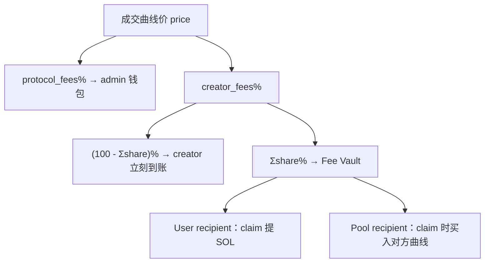
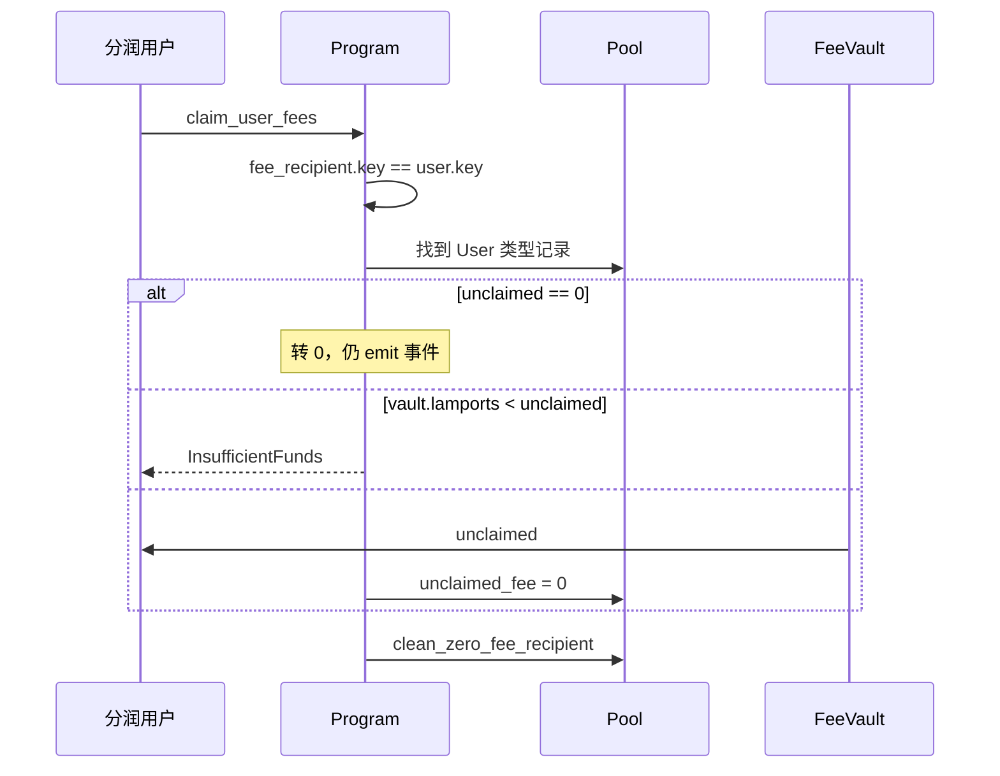
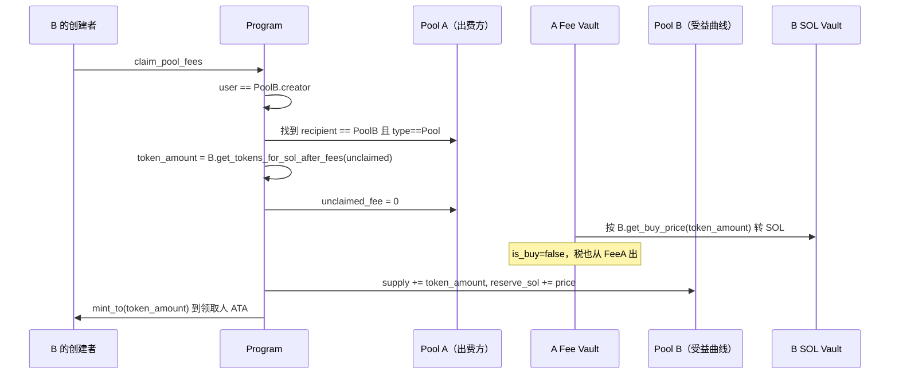

# 05 手续费与跨池分发

[English](05-fee-system.md) | [简体中文](05-fee-system.zh.md)

费用路由是 Stoa 的主要差异化功能：创建者可以把交易税分给贡献者，或分给**另一个 Stoa 池**，用手续费回购关联代币。链上对应 `claim_pool_fees`。

## 1. 两层费率

全局 `CurveConfiguration`：

| 字段 | 默认 | 含义 |
|------|------|------|
| `protocol_fees` | 2 | 协议税，始终给 `admin` |
| `creator_fees` | 5 | 创建者税，可再切分 |

池级 `Pool`：

| 字段 | 含义 |
|------|------|
| `fee_recipients[]` | 最多 10 个，类型 User 或 Pool |
| `total_fee_share_percentage` | 上述份额之和，≤ 100 |

每一笔成交的创建者税：

```
total_creator_fee = price * creator_fees / 100

pool_creator_immediate = total_creator_fee * (100 - total_fee_share_percentage) / 100
shared                    = total_creator_fee - pool_creator_immediate
```

- `pool_creator_immediate`：**立刻**转到 `pool_creator` 账户。
- `shared`：**立刻**转到本池 `pool_sol_fee_vault`，并按比例记到每个 recipient 的 `unclaimed_fee`。

协议税不进这张表，买卖当时就转给 `protocol_account`。



## 2. 买入 vs 卖出：税从哪出

`distribute_fees(is_buy, price, ...)`：

```rust
if is_buy {
    // 用户钱包再转三笔：协议 / 创建者 / fee vault
    transfer_sol_to_user(authority, protocol, protocol_fees);
    transfer_sol_to_user(authority, pool_creator, pool_creator_fees);
    transfer_sol_to_pool(authority, fee_vault, shared);
} else {
    // 从传入的 pool_sol_vault 扣（卖出是曲线储备；跨池 buy_with_vault 是源 fee vault）
    transfer_sol_from_pool(vault, protocol, protocol_fees);
    transfer_sol_from_pool(vault, pool_creator, pool_creator_fees);
    transfer_sol_from_pool(vault, fee_vault, shared);
}
```

记账（无论买卖）：

```rust
for recipient in fee_recipients.iter_mut() {
    let fee_share = total_creator_fee * share_percentage / 100;
    recipient.total_fee += fee_share;
    recipient.unclaimed_fee += fee_share;
}
```

整数除法会截断。`pool_creator_fees + Σ fee_share` 可能略小于 `total_creator_fee`，灰尘 lamports 留在付款账户。后续版本可以考虑用 bps（u16, /10_000）提高精度，并先累加再转账，避免逐项截断。

## 3. 配置分润

### `distribute_user_fee(share%)`

- 仅 `user == pool.creator`。
- `share% ≤ 100`。
- 若地址已在表中：更新其 `share_percentage`（不是再插一行）。
- 否则 `push` 新 `FeeRecipient { User, address, share, 0, 0 }`。
- 重新汇总 `total_fee_share_percentage`，超过 100 则整笔失败。
- 表长 ≥ 10 且是新地址 → `MaxFeeRecipientReached`。

### `distribute_pool_fee(share%)`

同上，外加：

```rust
if pool.key() == distribute_fee_pool.key() {
    return Err(InvalidRecipient); // 禁止分给自己
}
```

目标必须是另一个合法 Pool PDA（seeds 校验）。不能填一个随便的钱包冒充池子。

把份额改回 0 不会立刻删行，因为可能还有 `unclaimed_fee`。真正删除在领取后的 `clean_zero_fee_recipient`：

```rust
retain(share_percentage > 0 || unclaimed_fee > 0)
```

## 4. `claim_user_fees`



权限模型是 **领取人自己来领**，创建者不能代领到自己的钱包（除非创建者就是那个 recipient 地址）。

## 5. `claim_pool_fees`（依赖回购）

业务故事：仓库 A 依赖仓库 B。A 的创建者把 10% 的 creator 税分给 B 的 Pool。A 上每次成交，B 在 A 的 fee vault 里累积 SOL。B 的创建者来领取时，**不是把 SOL 提走**，而是用这笔 SOL 沿着 B 的曲线买 B 的 Share。



`buy_with_vault` 把 `is_buy=false` 传给 `distribute_fees`，因为付款账户不是用户钱包，而是 A 的 fee vault。于是：

- B 的协议费、B 的创建者费，都从 **A 的 fee vault** 再抽一次。
- 所以要用 `get_tokens_for_sol_after_fees`，按「毛额 SOL」反推扣税后还能买多少。

权限是 **B 的创建者**，不是 A 的创建者。A 只负责配置「分给谁」；B 决定何时把累积税转换成自己曲线上的买盘。

## 6. 一个数字例子

假设 `creator_fees=5`，`protocol_fees=2`，A 把 10% 分给 user U，10% 分给池 B，剩余 80% 归 A creator。某笔成交 `price = 1_000_000_000` lamports（1 SOL）。

| 去向 | 计算 | lamports |
|------|------|----------|
| 协议 | 1 SOL × 2% | 0.02 SOL |
| 创建者税合计 | 1 SOL × 5% | 0.05 SOL |
| A creator 立刻拿 | 0.05 × 80% | 0.04 SOL |
| Fee vault | 0.05 × 20% | 0.01 SOL |
| 其中 U 记账 | 0.05 × 10% | 0.005 SOL |
| 其中 B 记账 | 0.05 × 10% | 0.005 SOL |

- 若这是 **buy**：用户一共付 `1 + 0.02 + 0.05 = 1.07 SOL`，vault 进 1 SOL。
- 若这是 **sell**：用户收 `1 - 0.07 = 0.93 SOL`，vault 出 1 SOL。

U 之后 `claim_user_fees` 拿走 0.005 SOL。B 的创建者 `claim_pool_fees` 用约 0.005 SOL 去 B 的曲线买（还要再付 B 自己的 7% 税）。

## 7. 集成模式

| 集成模式 | 链上机制 |
|----------------|----------|
| 创建者/团队费 | `creator_fees` |
| 协议金库费 | `protocol_fees` |
| 贡献者分润 | `distribute_user_fee` + `claim_user_fees` |
| 依赖代币回购 | `distribute_pool_fee` + `claim_pool_fees` |

开源图谱是一张有向图：每个池可以把税指向多个上游依赖。合约用「禁止自指 + 最多 10 个接收者 + 总份额 ≤ 100%」把图的出度卡住，避免一次成交写爆账户。
